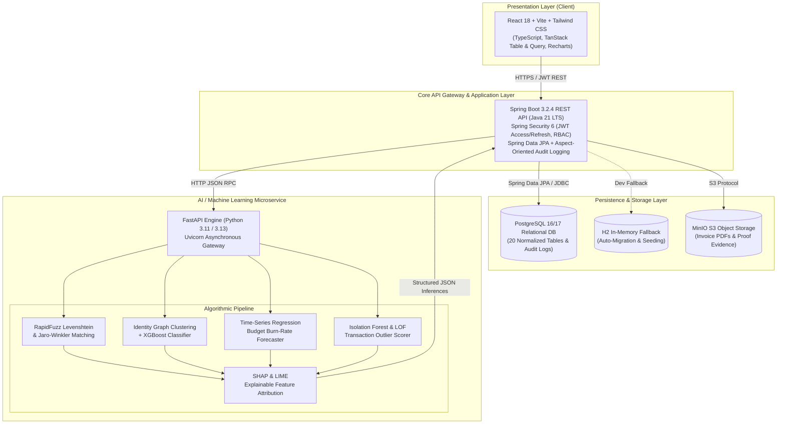

# AI Budget Guardian — Intelligent Government Financial Monitoring & Fraud Analytics Platform

[](https://www.oracle.com/java/)
[](https://spring.io/projects/spring-boot)
[](https://www.python.org/)
[](https://fastapi.tiangolo.com/)
[](https://reactjs.org/)
[](https://www.typescriptlang.org/)
[](https://www.postgresql.org/)
[](LICENSE)

---

## 1. Executive Summary

**AI Budget Guardian** is an enterprise-grade, production-style government financial monitoring platform designed to analyze public sector budget allocations, track expenditure lifecycles, and automatically detect procurement fraud, fake vendor identity cartels, and duplicate invoices.

Crucially, rather than relying on "black-box" machine learning predictions, the platform delivers **Explainable AI (XAI)** using **SHAP (SHapley Additive exPlanations)** and **LIME** to provide transparent, legally defensible feature attributions for statutory auditors before financial disbursements are made.

### Core Target Domains:
1. **Academic Defense & Research**: Final-year capstone, research publications, and viva voce defense.
2. **Portfolio & Enterprise Showcase**: Full-stack multi-service enterprise financial system.
3. **Public Sector Auditing Demonstrations**: Real-time fraud detection and case management.

---

## 2. Problem Statement & Research Objectives

### The Problem
* **Post-Mortem Auditing**: Traditional government audits occur months or years after payment release, resulting in delayed detection and near-zero asset recovery rates.
* **Duplicate Invoicing**: Vendors submit duplicate or near-identical invoices with minor typographical variations (Levenshtein distance anomalies) across department silos.
* **Shell & Collusive Vendor Rings**: Fraudulent entities share underlying bank accounts, PAN/GST credentials, and physical addresses to manipulate public tenders.
* **Black-Box AI Skepticism**: Conventional AI systems generate risk scores without explainable evidence, leaving statutory auditors unable to legally justify holding payments.

### The Objectives
1. **Real-Time Pre-Disbursement Interception**: Intercept invoices and purchase orders at submission time in sub-50ms.
2. **Multi-Vector Identity Graph Analysis**: Uncover hidden vendor rings through shared GSTIN, PAN, bank accounts, and addresses.
3. **Budget Depletion Forecasting**: Use time-series regression to project budget exhaustion dates and curb year-end fiscal dumping.
4. **Legally Defensible Explainable AI**: Implement SHAP to break down predictions into ranked feature impacts and automated auditor actions.
5. **Role-Segregated Auditing Workflow**: Provide an end-to-end investigation workspace supporting evidence review, case logging, and immutable audit trails.

---

## 3. Platform Architecture



---

## 4. Key Functional Modules & Machine Learning Pipeline

| Module Name | Approach / Technology | Methodology | Primary Output |
|---|---|---|---|
| **Duplicate Invoice Detection** | Rule-Based + String Similarity | RapidFuzz Levenshtein & Jaro-Winkler token matching on invoice numbers, amounts, and dates | Similarity Score (0-100%), Matching Target Invoice ID |
| **Fake Vendor Identification** | Identity Graph + XGBoost | Graph clustering of shared GSTIN, PAN, bank accounts, and addresses + gradient boosting | Vendor Risk Score (0-100), Risk Level (LOW to CRITICAL) |
| **Overpayment Reconciliation** | Multi-Factor Reconciliation | Purchase Order contract rate vs. Invoice rate variance and item benchmarks | Price Variance Percentage, Excess Amount (₹) |
| **Budget Burn-Rate Forecasting** | Time-Series Regression | Historical departmental disbursement tracking against approved appropriations | Projected Depletion Date, 90-Day Warning Flags |
| **Explainable AI (SHAP)** | Cooperative Game Theory | Local feature attribution calculating exact marginal contributions per transaction | Base Value, Feature Impact Ranks, Auditor Recommendations |
| **Auditor Investigation Portal** | State Machine Workflow | Queue management, evidence archiving, auditor findings, case status transitions | Immutable Case Record, Formal Audit Report |

---

## 5. Technology Stack

* **Frontend**: React 18, TypeScript, Vite, Tailwind CSS, TanStack Query v5, TanStack Table v8, Recharts, Lucide Icons
* **Backend**: Java 21 LTS, Spring Boot 3.2.4, Spring Security 6, Spring Data JPA, Hibernate ORM, JJWT 0.12.5, Maven 3.9+
* **Database**: PostgreSQL 16/17 (Local / Production) or H2 Database (In-Memory Development Fallback)
* **AI Microservice**: Python 3.11 / 3.13, FastAPI, Uvicorn, Scikit-learn, XGBoost, SHAP, LIME, RapidFuzz, Pandas, NumPy
* **Storage**: MinIO S3 Object Storage (Invoice PDFs & attachments)
* **Presentation**: Pre-compiled PowerPoint presentation deck (`docs/AI_Budget_Guardian_Project_Defense.pptx`)

---

## 6. Demo Login Credentials

The platform is pre-seeded with 4 distinct human roles and 1 automated service principal:

| Role | Email | Password | Primary Scope & Access |
|---|---|---|---|
| **Super Admin** | `admin@aibudget.gov.in` | `Password123!` | System governance, department appropriations, user management, global audit logs |
| **Finance Officer** | `finance.officer@aibudget.gov.in` | `Password123!` | Purchase order creation, invoice uploads, disbursement processing |
| **Department Manager** | `dept.manager@aibudget.gov.in` | `Password123!` | Department budget monitoring, contractor evaluations, budget adjustment requests |
| **Lead Auditor** | `auditor@aibudget.gov.in` | `Password123!` | AI fraud alert triage, evidence review, case resolution, formal finding logs |

---

## 7. Quickstart Guide (Local Development)

### Prerequisites
* **Java 21 JDK** (Oracle, Microsoft OpenJDK, or Eclipse Temurin)
* **Maven 3.9+**
* **Python 3.11+** or **3.13+**
* **Node.js v20+** and **npm**
* *(Optional)* **PostgreSQL 16/17** (defaults to H2 in-memory if PostgreSQL is not active)

---

### Step 1: One-Click Startup (Windows)
If running locally on Windows, simply double-click or run:
```cmd
start_all.bat
```
This automatically launches all three services in separate command windows:
* **Frontend**: `http://localhost:5173`
* **Backend REST API**: `http://localhost:8080` (Swagger UI at `/swagger-ui.html`)
* **AI Microservice**: `http://localhost:8000` (FastAPI Docs at `/docs`)

---

### Step 2: Manual Component Startup

#### 1. Start Backend REST API (Java 21 Spring Boot)
```bash
cd backend

# Option A: With local Maven
mvn clean compile
mvn spring-boot:run

# Option B: Windows with JDK 21 launcher script
mvn21.bat spring-boot:run
```
*Backend runs on `http://localhost:8080`*  
*Actuator Health: `http://localhost:8080/actuator/health`*  
*Swagger Documentation: `http://localhost:8080/swagger-ui.html`*

#### 2. Start AI Microservice (FastAPI)
```bash
cd ai-service

# Create virtual environment
python -m venv venv

# Activate virtual environment
# Windows:
venv\Scripts\activate
# Linux/macOS:
source venv/bin/activate

# Install dependencies
pip install -r requirements.txt

# Run AI service
uvicorn app.main:app --reload --host 0.0.0.0 --port 8000
```
*AI Engine runs on `http://localhost:8000`*  
*Interactive API Docs: `http://localhost:8000/docs`*

#### 3. Start Frontend Client (React Vite)
```bash
cd frontend
npm install
npm run dev
```
*Frontend application runs on `http://localhost:5173`*

---

## 8. Database Setup (PostgreSQL or H2)

### Option A: Local PostgreSQL Setup (Recommended for Persistence)
1. Ensure PostgreSQL 16 or 17 is running locally.
2. Create the database:
```sql
CREATE DATABASE aibudgetdb;
```
3. Run the migrations:
```bash
psql -h localhost -p 5432 -U postgres -d aibudgetdb -f backend/src/main/resources/db/migration/V1__init_schema.sql
psql -h localhost -p 5432 -U postgres -d aibudgetdb -f backend/src/main/resources/db/migration/V2__seed_data.sql
```
4. Configure `.env` or `backend/src/main/resources/application.yml`:
```yaml
spring:
  datasource:
    url: jdbc:postgresql://localhost:5432/aibudgetdb
    username: postgres
    password: your_password
    driver-class-name: org.postgresql.Driver
```

### Option B: In-Memory H2 Setup (Zero Configuration)
Set `SPRING_DATASOURCE_URL=jdbc:h2:mem:aibudgetdb;DB_CLOSE_DELAY=-1;MODE=PostgreSQL`. Schema and demo seed data are initialized automatically in RAM on startup.

---

## 9. Explainable AI (XAI) Sample Payload

When a transaction is analyzed, the AI engine returns a transparent SHAP-attributed JSON response:

```json
{
  "riskScore": 87.5,
  "riskLevel": "HIGH",
  "confidence": 0.94,
  "influencingReasons": [
    "Invoice unit price is 38.2% higher than approved purchase order benchmark.",
    "Vendor shares registered bank account with another entity (Vendor ID: V-8821).",
    "Invoice submitted at 02:14 AM outside standard operating hours."
  ],
  "featureAttributions": [
    { "feature": "price_variance_pct", "shapValue": 0.42, "description": "High price deviation from purchase order" },
    { "feature": "shared_bank_account", "shapValue": 0.35, "description": "Multiple vendors using identical bank account" },
    { "feature": "off_hours_submission", "shapValue": 0.17, "description": "Transaction submitted during non-working hours" }
  ],
  "recommendedAction": "Place payment disbursement on hold and assign Lead Auditor for site verification."
}
```

---

## 10. Project Presentation & Academic Defense Materials

A PowerPoint presentation has been generated for academic defense, viva voce, and project reviews:
* **Presentation File**: [`docs/AI_Budget_Guardian_Project_Defense.pptx`](docs/AI_Budget_Guardian_Project_Defense.pptx)
* **Topics Covered**: Problem Statement, Objectives, Multi-tier Methodology, Algorithmic Implementation, Experimental Results, Future Scope, and Sample Examination Q&A.
* **Full Architecture Documentation**: [`docs/architecture/system_architecture.md`](docs/architecture/system_architecture.md)
* **AI Architecture & Algorithms**: [`docs/ai/ai_service_architecture.md`](docs/ai/ai_service_architecture.md)

---

## 11. Testing & Verification

Run automated test suites across backend and AI services:

```bash
# Backend unit & integration tests
cd backend && mvn clean test

# AI Engine test suite
cd ai-service && pytest tests/test_ai_engine.py
```

---

## 12. License & Citation

Developed for academic research and enterprise public financial monitoring. Released under the [MIT License](LICENSE).
